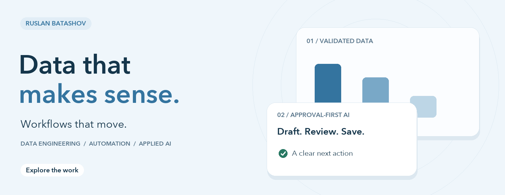
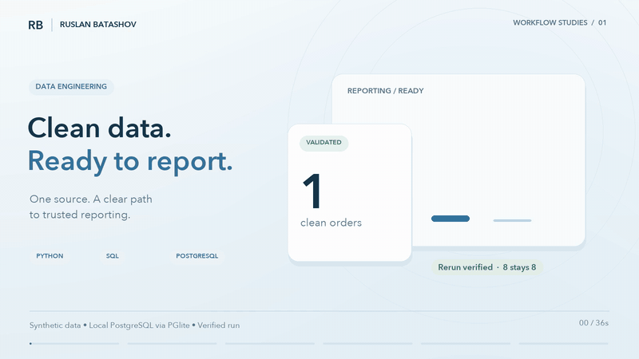
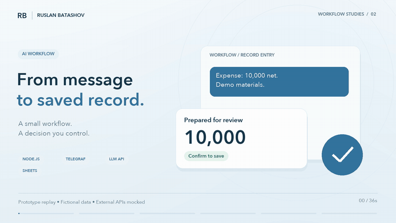

# Data & AI, made tangible.

Two short walkthroughs of practical engineering: **clean reporting data** and **an AI-assisted workflow with an explicit approval step**. Each film comes with runnable code and inspectable evidence.

**[Work with me on Upwork](https://www.upwork.com/freelancers/~015390bdf829b6c3be)** · [GitHub profile](https://github.com/islamwers) · [Run both examples](#run-the-examples)

## 01 / ETL — clean data, ready to report

[](media/etl-demo-en.mp4)

**[Watch the film ↗](media/etl-demo-en.mp4)** · [Read the case](etl/README.md) · [Inspect the run](evidence/etl-run.json)

A fictional order file becomes a validated PostgreSQL table and a reconciled report. Invalid rows remain visible in a rejection report; repeated loads do not add duplicate orders.

| Input | Transformation | Verified result |
| :-- | :-- | :-- |
| 12 fictional rows | 3 rejected, 1 duplicate resolved | 8 clean orders; 8 after rerun |

**Python · SQL · PostgreSQL through PGlite**

## 02 / AI — from message to saved record

[](media/ai-demo-en.mp4)

**[Watch the film ↗](media/ai-demo-en.mp4)** · [Read the case](ai/README.md) · [Inspect the replay](evidence/ai-run.json)

The original Telegram prototype handlers turn a prepared model response into a reviewable entry. A user confirms it, the handler appends one row, and the bot reads it back.

| Before confirmation | After confirmation | Verified result |
| :-- | :-- | :-- |
| 0 writes | 1 sample row | Saved amount appears in read-back |

**Node.js · Telegraf · DeepSeek integration · Google Sheets integration**

## Run the examples

Requirements: **Node.js 22+**, **Python 3.10+**, and **pnpm**. No API keys, paid services or database server are needed for these local examples.

```sh
git clone https://github.com/islamwers/data-ai-workflows.git
cd data-ai-workflows
pnpm install --frozen-lockfile
pnpm test
```

Run one example with `pnpm demo:etl` or `pnpm demo:ai`. Generated JSON reports are written to `evidence/`. The ETL database is recreated in memory for each execution; the script loads the batch twice into that same database.

## What these demonstrations establish

- **ETL:** actual Python transformation and SQL execution in [PGlite](https://pglite.dev/docs/), an embedded PostgreSQL build. Assertions check repeat-run equality, report reconciliation and transaction rollback.
- **AI:** actual handlers from [tgbot_salary](https://github.com/islamwers/tgbot_salary). Telegram, the language model and Google Sheets are mocked. The model response is a fixed fixture; this is a workflow replay, not a model-quality benchmark or live deployment.
- **Visuals:** original English motion graphics presenting the verified runs. They are explanatory interfaces, not client screenshots. All records are fictional. No performance, revenue-growth or time-saving claims are inferred from these fixtures.

## Start with one concrete workflow

Send me a sample input, the output you need and the step that currently takes manual work. I can help define the data rules, integration points, approval boundaries and handover.

**[Discuss your workflow on Upwork ↗](https://www.upwork.com/freelancers/~015390bdf829b6c3be)**
