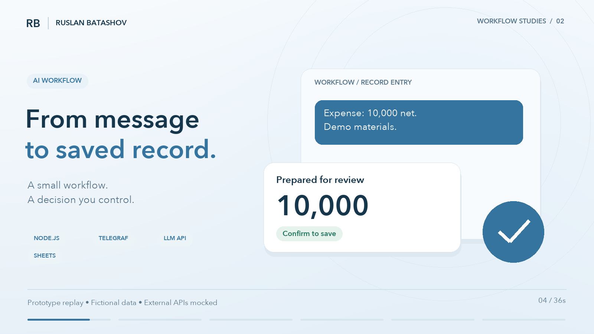
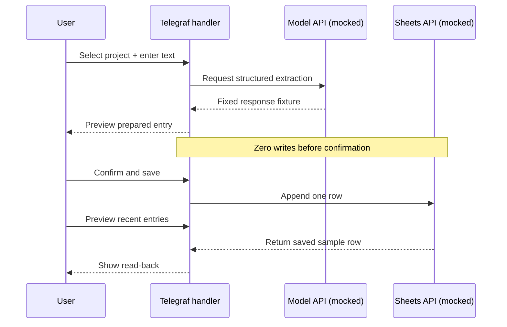

# AI / From message to saved record.

[](../media/ai-demo-en.mp4)

**[Watch the 36-second film](../media/ai-demo-en.mp4)** · [Replay evidence](../evidence/ai-run.json) · [Original prototype](https://github.com/islamwers/tgbot_salary)

The useful part of an AI integration is the action it helps a person complete. This prototype prepares a financial entry for review, waits for explicit confirmation and saves the approved row.



## What actually runs

[`run-demo.cjs`](run-demo.cjs) executes the original [`prototype-index.cjs`](prototype-index.cjs) inside a Node.js VM with controlled dependencies. Assertions verify:

1. **No write before confirmation.** Preparing an entry leaves the sheet empty.
2. **One confirmed sample row.** The handler appends the exact expected six-cell row.
3. **Read-back.** The saved amount appears in the next preview response.

```sh
node ai/run-demo.cjs
```

No credentials or dependency installation are required for the AI replay. The original source is preserved at Git blob `87659dc076997b35a147b207f2c52e5cad0d0818` from [islamwers/tgbot_salary](https://github.com/islamwers/tgbot_salary).

## What the film represents

The English interface is a designed explanation of the recorded flow. The original bot's messages are in Russian, preserved in the evidence. A fixed model response contains a fictional expense with a net amount of **10,000**, date **2026-10-01** and note **Demo materials**.

The prototype calculates a fixed 20% tax field. The full recorded row contains net 10,000, gross 12,000 and tax 2,000. The film simplifies the view to its net amount and note; it is not accounting or tax advice.

**Scope:** Telegram, DeepSeek and Sheets are mocked in this replay. The checks establish the exercised happy-path handler behavior. They do not establish live model accuracy, resistance to prompt injection, payment processing, concurrency safety, authorization hardening or end-to-end idempotency. The code is a public prototype, not a production readiness claim.

For a client workflow, the next design step is to define the action schema, validation rules, approval boundary, failure handling and integration credentials.

[Discuss an AI workflow](https://www.upwork.com/services/product/development-it-an-ai-agent-to-automate-one-business-workflow-with-api-integrations-2106434117650359893)
