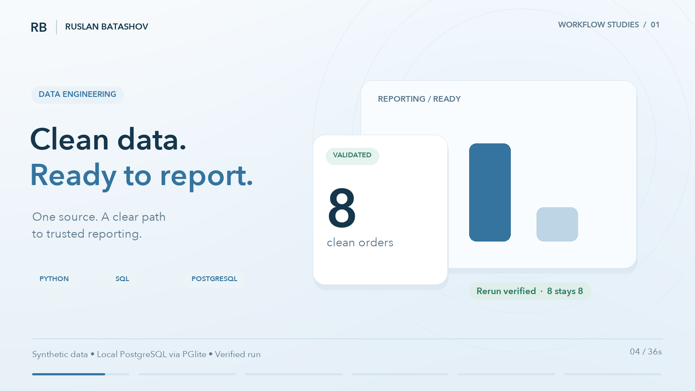
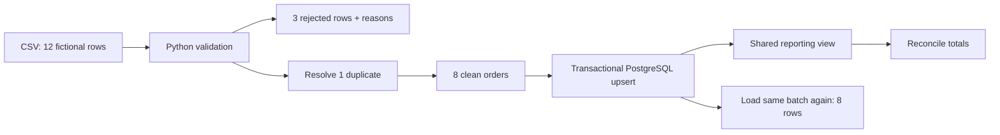

# ETL / Clean data. Ready to report.

[](#watch-the-demo)

**[Watch the 36-second film](#watch-the-demo)** · [Run evidence](../evidence/etl-run.json) · [Back to the showcase](../README.md)

## Watch the demo

https://github.com/user-attachments/assets/c377bd69-64c4-4ce7-80c1-96156168b4f0

[Download the MP4](../media/etl-demo-en.mp4) · Silent film with English on-screen text.

## The workflow

A reporting table should have clear definitions, explainable rejections and predictable reruns. This small example makes those properties visible.



## The verified run

| Check | Result |
| :-- | :-- |
| Source rows | 12 |
| Rejected rows | 3: missing ID, invalid date, invalid amount |
| Duplicate rule | Last valid row in this input file wins |
| Distinct valid orders | 8 |
| Table after the same batch is loaded again | Exactly the same 8 rows |
| Reporting total | USD 1,505.00, matching clean input |
| Failed transaction | Rolled back; no partial row left behind |

The synthetic report groups **Organic: 545.10**, **Paid Search: 710.00** and **Referral: 249.90**. These are fixture values, not client results.

## Inspect the implementation

- [`source.csv`](source.csv): entirely fictional input.
- [`transform.py`](transform.py): trimming, channel/currency normalization, strict date and decimal validation, deterministic deduplication, rejection reasons.
- [`schema.sql`](schema.sql): primary key, constraints and one reporting view.
- [`load.mjs`](load.mjs): parameterized upsert, transactional batch, rerun comparison, reconciliation and rollback checks.
- [`etl-transform.json`](../evidence/etl-transform.json): accepted rows, rejected rows and replacement policy.

```sh
pnpm demo:etl
```

**Scope:** a reproducible one-source batch example. PostgreSQL runs locally through PGlite/WebAssembly; the loader is JavaScript and the transformation is Python. It does not demonstrate a deployed scheduler, distributed ingestion, live connectors, monitoring, large-scale performance or production credential management. Those require project-specific design and verification.

For your project, the first deliverable can be one validated source-to-table path, documented rules and a repeatable run procedure.

[Discuss an ETL project](https://www.upwork.com/services/product/development-it-a-reliable-python-etl-pipeline-for-your-reporting-data-2106431168435338119)
